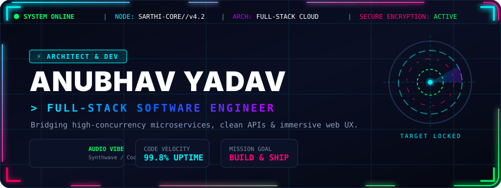
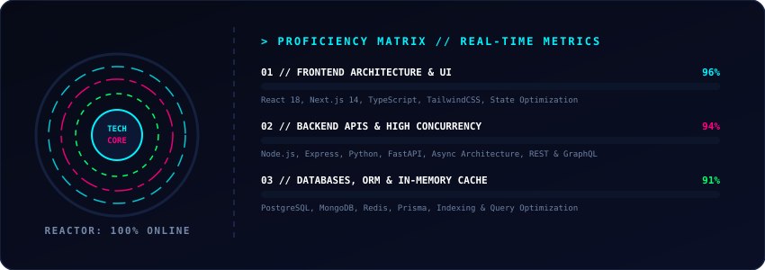

<div align="center">

<!-- Holographic Sci-Fi Animated Cyber Header -->
<a href="https://github.com/sarthi278">
  
</a>

<br><br>

<!-- Multi-Color Animated Typing SVG -->
<a href="https://github.com/sarthi278">
  
</a>

<p align="center">
  <a href="https://github.com/sarthi278"></a>
  <a href="https://github.com/sarthi278"></a>
  <a href="https://github.com/sarthi278"></a>
</p>

</div>

---

### 🏆 `sys.telemetry --trophies`

<div align="center">
  <a href="https://github.com/sarthi278">
    
  </a>
</div>

---

### ⚡ `sys.modules --proficiency-matrix`

<div align="center">
  <!-- Animated Tech Reactor Core & Proficiency Matrix SVG -->
  
</div>

<br>

<div align="center">
  <!-- Interactive Tech Stack Icons Grid -->
  <a href="https://skillicons.dev">
    
  </a>
</div>

---

### 🕹️ `sys.autonomous --contribution-snake`

<div align="center">
  <!-- Autonomous Snake Game Navigating Contribution Grid -->
  
</div>

<p align="center">
  <i>Autonomous neural snake actively consuming commit nodes across the GitHub timeline.</i>
</p>

---

### 📊 `sys.metrics --performance-diagnostics`

<div align="center">

<table>
  <tr>
    <td width="50%">
      
    </td>
    <td width="50%">
      
    </td>
  </tr>
  <tr>
    <td colspan="2">
      
    </td>
  </tr>
</table>

</div>

---

### 📈 `sys.activity --commit-frequency`

<div align="center">
  
</div>

---

### 💻 `cat /etc/developer_manifesto.json`

```json
{
  "developer": "Anubhav Yadav",
  "callsign": "sarthi278",
  "role": "Full-Stack Software Architect",
  "specialties": [
    "High-Performance Web Applications (React / Next.js)",
    "Scalable Backend Services & REST APIs (Node.js / Python)",
    "Optimized Relational & NoSQL Datastores (PostgreSQL / MongoDB)",
    "Containerization & Microservices (Docker / Linux)"
  ],
  "mantra": "Ship fast, optimize fearlessly, and build software that feels like magic."
}
```

---

### 📡 `sys.network --open-frequencies`

<div align="center">

<a href="https://www.linkedin.com/in/anubhav-yadav-it27/" target="_blank">
  
</a>
&nbsp;
<a href="https://github.com/sarthi278" target="_blank">
  
</a>

<br><br>

<!-- Cyber Glowing Wave Footer -->


</div>
