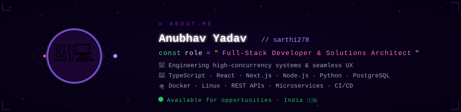

<!-- ═══════════════════════════════════════════════════════════════════════
     ANUBHAV YADAV · @sarthi278 · GitHub Profile README
     Universe Theme — Cosmic Vibes, Proven Services Only
     ═══════════════════════════════════════════════════════════════════════ -->

<!-- ╔══════════════════════════════════════════════════════════════╗
     ║  🌌 HERO HEADER — capsule-render (guaranteed working)       ║
     ╚══════════════════════════════════════════════════════════════╝ -->

  

<!-- ╔══════════════════════════════════════════════════════╗
     ║           ⌨️  ANIMATED TYPING                        ║
     ╚══════════════════════════════════════════════════════╝ -->

  

<!-- ╔══════════════════════════════════════════════════════╗
     ║           🔗 SOCIAL LINKS ROW                        ║
     ╚══════════════════════════════════════════════════════╝ -->

  &nbsp;
  &nbsp;
  &nbsp;
  &nbsp;
  

  

 

<!-- ╔══════════════════════════════════════════════════════╗
     ║           👨‍💻 ABOUT SECTION                          ║
     ╚══════════════════════════════════════════════════════╝ -->

 

<!-- ╔══════════════════════════════════════════════════════╗
     ║           🏆 ACHIEVEMENTS                            ║
     ╚══════════════════════════════════════════════════════╝ -->
<h2 align="center">🏆 &nbsp; Proof, On The Record</h2>

| 🎯 LeetCode | 🌟 HackerRank | 📦 Repositories | ⚡ Uptime |
|:---:|:---:|:---:|:---:|
| Active Solver | ⭐⭐⭐⭐⭐ 5 Stars | 35+ Active | 99.8% |

 

<!-- ╔══════════════════════════════════════════════════════╗
     ║           🛠️ TECH ARSENAL                            ║
     ╚══════════════════════════════════════════════════════╝ -->

 

<!-- ── Extra tech badges row (always works - shields.io) ── -->

  
  
  
  
  
  
  
  
  
  

 

<!-- ╔══════════════════════════════════════════════════════╗
     ║           💼 SELECTED WORK                           ║
     ╚══════════════════════════════════════════════════════╝ -->
<h2 align="center">🚀 &nbsp; Selected Work — Products, Not Assignments</h2>

  <table border="0" cellspacing="0" cellpadding="8">
    <tr>
      <td width="50%" valign="top">
        <h3>🌐 Portfolio 2.0 Web Platform</h3>
        
Full-stack personal portfolio built with <strong>Next.js 14</strong>, <strong>TypeScript</strong>, <strong>Tailwind CSS</strong>, deployed on Vercel with 99.8% uptime.

        

          
          
          
        

        
      </td>
      <td width="50%" valign="top">
        <h3>⚡ Resilient API Core — Microservices</h3>
        
High-concurrency REST API system using <strong>Node.js</strong>, <strong>Express</strong>, <strong>PostgreSQL</strong>, and <strong>Docker</strong>. Built for horizontal scalability.

        

          
          
          
        

        
      </td>
    </tr>
  </table>

 

<!-- ╔══════════════════════════════════════════════════════╗
     ║           📊 GITHUB STATS                            ║
     ╚══════════════════════════════════════════════════════╝ -->
<h2 align="center">📊 &nbsp; GitHub Universe Stats</h2>

  
  &nbsp;&nbsp;
  

 

  

 

<!-- ╔══════════════════════════════════════════════════════╗
     ║           🌌 CONTRIBUTION SNAKE                      ║
     ╚══════════════════════════════════════════════════════╝ -->
<h2 align="center">🌌 &nbsp; Contribution Universe — A Year of Commits</h2>

  <picture>
    <source media="(prefers-color-scheme: dark)"  srcset="https://raw.githubusercontent.com/sarthi278/sarthi278/output/github-contribution-grid-snake-dark.svg"/>
    <source media="(prefers-color-scheme: light)" srcset="https://raw.githubusercontent.com/sarthi278/sarthi278/output/github-contribution-grid-snake.svg"/>
    
  </picture>

 

<!-- ╔══════════════════════════════════════════════════════╗
     ║           📈 ACTIVITY GRAPH                          ║
     ╚══════════════════════════════════════════════════════╝ -->

  

 

<!-- ╔══════════════════════════════════════════════════════╗
     ║           🎮 LEETCODE CARD                           ║
     ╚══════════════════════════════════════════════════════╝ -->

  

 

<!-- ╔══════════════════════════════════════════════════════╗
     ║           🤝 CONNECT SECTION                         ║
     ╚══════════════════════════════════════════════════════╝ -->
<h2 align="center">🤝 &nbsp; Let's Build Something Worth Explaining</h2>

  &nbsp;
  &nbsp;
  &nbsp;
  &nbsp;
  

 

<!-- ╔══════════════════════════════════════════════════════╗
     ║           🌌 COSMIC FOOTER                           ║
     ╚══════════════════════════════════════════════════════╝ -->

<!-- Wave footer — capsule-render (proven) -->

  

<!-- ═══════════════════════════════════════════════════════
     Made with 🌌 by Anubhav Yadav | @sarthi278
     "The cosmos is within us. We are made of star-stuff."
     ═══════════════════════════════════════════════════════ -->
